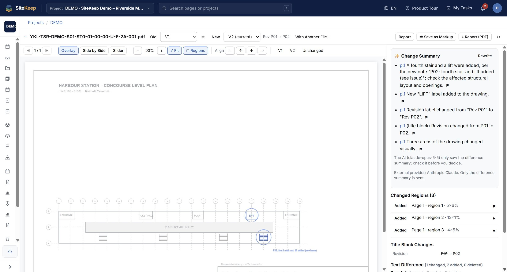
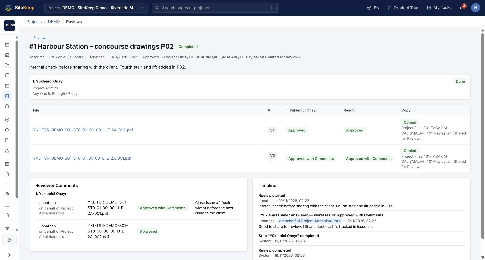
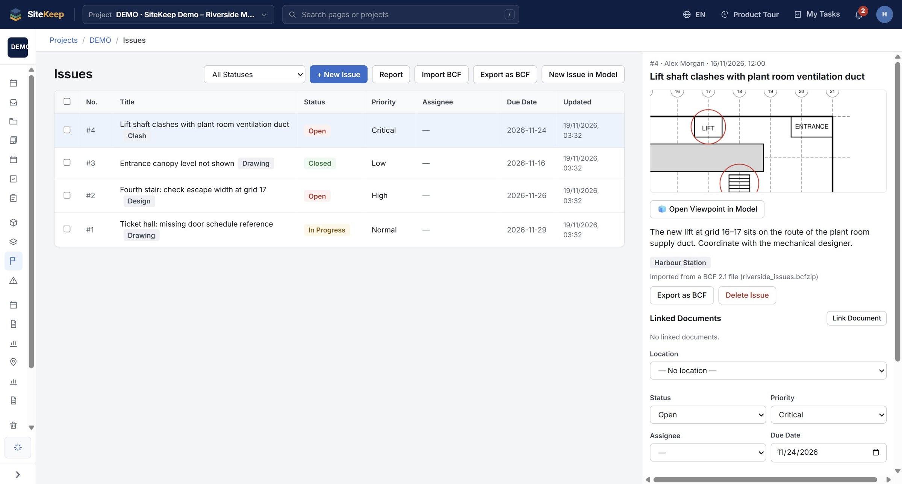
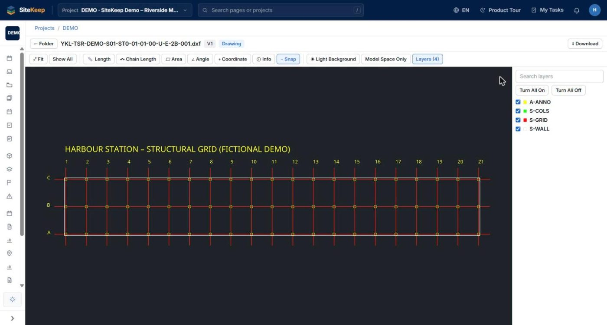

<p align="center"></p>

# SiteKeep

**An open-source, privacy-first common data environment (CDE) for construction projects.**

SiteKeep keeps a project's documents, BIM models, issues and approvals in one place, on your own server.
It follows ISO 19650 and implements the buildingSMART OpenCDE and BCF standards. The 3D viewer is built on
[That Open Company](https://thatopen.com) components.

[Türkçe README](README.tr.md)

| Edition | What it is |
|---|---|
| **SiteKeep Community** | This repository, free under the [AGPL-3.0](LICENSE): documents, folder permissions, versions, naming standards, review workflows, ISO 19650 rules and audit log, drawing sheets, comparison and markup, issues and BCF, model viewer, transmittals and correspondence, report lists with CSV export, OpenCDE APIs. No licence, no limits. |
| **SiteKeep Enterprise** | Community plus paid modules: Cost, Field, Coordinate, Planning, AI, Manage, Connect, Platform ([modules](docs/modules/README.md)). Licensed per installation; the modules are not in this repository. |

The user interface is available in English and Turkish.

## Features

| Area | What you get |
|---|---|
| Users | Local users, companies, system and project administrators, Google sign-in, API access keys |
| Projects | ISO 19650 folder template (Work in progress / Shared / Published / Archived), members, roles |
| Folders | Folder tree with six permission levels per person or company, inherited downwards |
| Files | Drag-and-drop upload, versioning (same name = new version), attributes, SHA-256, document comparison |
| Naming | Per-project naming standards bound to folders and enforced on upload |
| Models | IFC → That Open Fragments conversion on the server, federated viewer, element selection and properties, DWG and PDF previews |
| Issues | 3D pins, BCF viewpoints (camera, models, selected elements, snapshot), status, priority, assignee, due date, BCF import / export |
| Reviews | Review and approval chains on documents |
| ISO 19650 | Per-project rules: state transitions only through review, archive on publication, suitability and revision codes, unique document codes, task-team WIP; clause map and test pack in [ISO 19650 alignment](docs/compliance/ISO19650.md) (ISO 19650-aligned; there is no ISO 19650 certification for software) |
| Audit | Every write, view and download is recorded in an append-only, hash-chained audit log with CSV export |
| Reports | A list per area (documents, issues, works, reviews …) with the viewer's permissions and CSV export; report dashboards (templates, AI, sharing, versions) come with the Enterprise Platform module |
| Integrations | REST API (`/api/v1`), OpenCDE, a local stdio MCP server for AI assistants (`apps/mcp`), office-to-PDF conversion (Gotenberg, ONLYOFFICE, Collabora); a hosted MCP endpoint (`/mcp`) comes with the Enterprise AI module |
| Privacy | The server sends nothing out on its own unless an administrator enables an integration (AI, e-mail, sign-in, Autodesk); every outbound connection is listed in the Privacy Centre, logged and can be switched off |

## Screenshots

Screenshots from a fictional demo project (Riverside Metro Line).

| | |
|---|---|
| <br>**Version comparison:** changed regions, title block and text between two revisions of a drawing. | <br>**Review and approval:** results per file, a full timeline, and approved files copied to Shared. |
| <br>**Issues and BCF:** issues imported from BCF, with snapshot, status, priority and comments. | <br>**DWG and DXF in the browser:** layers, measurements and snapping without CAD software. |

## Quick start (Docker)

You need Docker 24+ with Compose v2.

```bash
git clone https://github.com/sitekeephq/sitekeep.git && cd sitekeep
cp .env.example .env      # change ADMIN_EMAIL, ADMIN_PASSWORD and POSTGRES_PASSWORD
docker compose up -d
```

Open `http://your-server:8080` and sign in with the administrator account from `.env`. For HTTPS put a reverse
proxy (Caddy, nginx, IIS ARR) in front and set `SECURE_COOKIES=1` and `CDE_TRUST_PROXY=1`.

Back up the two volumes together: `pgdata` (database) and `cdedata` (files and model derivatives).

```bash
docker compose exec db pg_dump -U cde cde | gzip > backup-$(date +%F).sql.gz
```

For servers without internet access there is a single-file installation bundle with HTTPS, nightly backups,
upgrades and rollback; download it from the [releases](https://github.com/sitekeephq/sitekeep/releases).

## Development

Node.js 22 or newer.

```bash
npm ci
npm run build -w @sitekeephq/bim-viewer   # the 3D viewer; again after changing it
cp apps/server/.env.development.example apps/server/.env.development   # set the admin e-mail and password
npm run dev -w @sitekeep/server      # API → http://127.0.0.1:8787
npm run dev -w @sitekeep/web         # web app → http://localhost:5173
npm test                             # unit and API tests
npm run build && npm run e2e:install && npm run e2e   # end-to-end tests (Playwright)
```

Without `DATABASE_URL` the server uses an embedded PostgreSQL (PGlite) under `DATA_DIR/db`; no other service is needed.

## Architecture

```
packages/shared     permission levels and inheritance, naming validation, shared types
packages/bim-viewer 3D viewer engine and React integration (That Open Components)
packages/sdk        module SDK (MIT): how SiteKeep Enterprise modules plug into the core
packages/cde-tools  cde_* MCP tools (the stdio server and the AI module's /mcp endpoint share them)
apps/server         Fastify + Drizzle ORM (PostgreSQL / PGlite), local disk storage, IFC conversion queue
apps/web            React + That Open Components viewer
apps/mcp            stdio MCP server, with local file upload / download tools
```

Permission and naming rules live in one place (`packages/shared`); the server, the web app and MCP use the same code.

## Connecting AI assistants (MCP)

SiteKeep Community includes a local MCP server (`apps/mcp`, stdio) that runs on the user's computer and talks to
the server's REST API. Any MCP client (Claude Code, Claude Desktop, Cline, Open WebUI, LibreChat …) can start it.
It uses an API access key created under **My account → API access keys**; every call runs with the user's own
permissions and is written to the audit log. Local file upload and download tools are available here only.

```json
{
  "mcpServers": {
    "sitekeep": {
      "command": "node",
      "args": ["/path/to/sitekeep/apps/mcp/dist/index.js"],
      "env": { "CDE_URL": "https://your-server", "CDE_TOKEN": "<access key>" }
    }
  }
}
```

`CDE_READ_ONLY=1` switches the write tools off. Keys are read-only by default; read-write keys need the
administrator's permission and can be limited to projects and to a lifetime.

A hosted MCP endpoint on the server (`https://your-server/mcp`, Streamable HTTP, no local install) is part of the
Enterprise [AI module](docs/modules/ai.md).

## Documentation

Start with the **[map](docs/MAP.md)**: what belongs to Community and what to an Enterprise module, where code goes, and which rules apply.

- [Docker Compose installation](docs/onprem/docker-compose.md) and [installation bundle](docs/onprem/installation-bundle.md)
- [Backups](docs/onprem/backups.md), [monitoring](docs/onprem/monitoring.md), [capacity](docs/onprem/capacity.md)
- [Repository structure](docs/architecture/structure.md) and [tests](docs/architecture/tests.md)
- [Modules and the SDK](docs/modules/README.md)
- Features: [OpenCDE](docs/features/OPENCDE.md), [BCF](docs/features/BCF.md), [viewers](docs/features/VIEWERS.md), [privacy](docs/features/PRIVACY.md), [reports](docs/features/REPORTS.md), [office integration](docs/features/OFFICE_INTEGRATION.md), [AI providers](docs/features/AI_PROVIDERS.md)
- [All documents](docs/README.md)

## Contributing and security

Contributions are welcome: see [CONTRIBUTING.md](CONTRIBUTING.md) and the [code of conduct](CODE_OF_CONDUCT.md).
Report security problems privately as described in [SECURITY.md](SECURITY.md), never in a public issue.

## Licence

SiteKeep Community is licensed under the [GNU Affero General Public License v3.0](LICENSE). The module SDK
(`packages/sdk`) is MIT. Third-party components keep their own licences (That Open Components / Fragments: MIT,
web-ifc: MPL-2.0); all of them are listed in [THIRD_PARTY_NOTICES.md](THIRD_PARTY_NOTICES.md).

The SiteKeep name and logos are trademarks of 7Dimensions OÜ and are not covered by the AGPL; see
[TRADEMARKS.md](TRADEMARKS.md).
