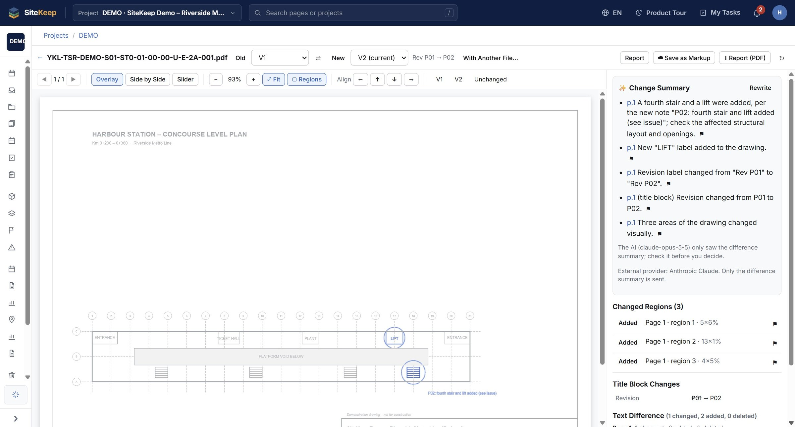
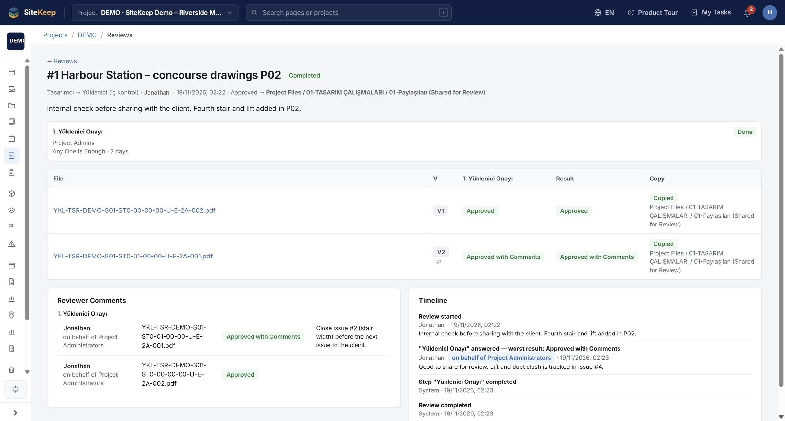
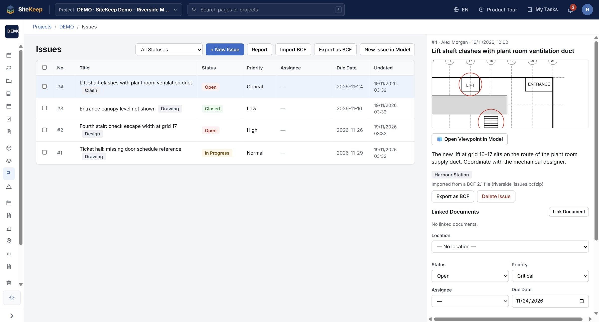
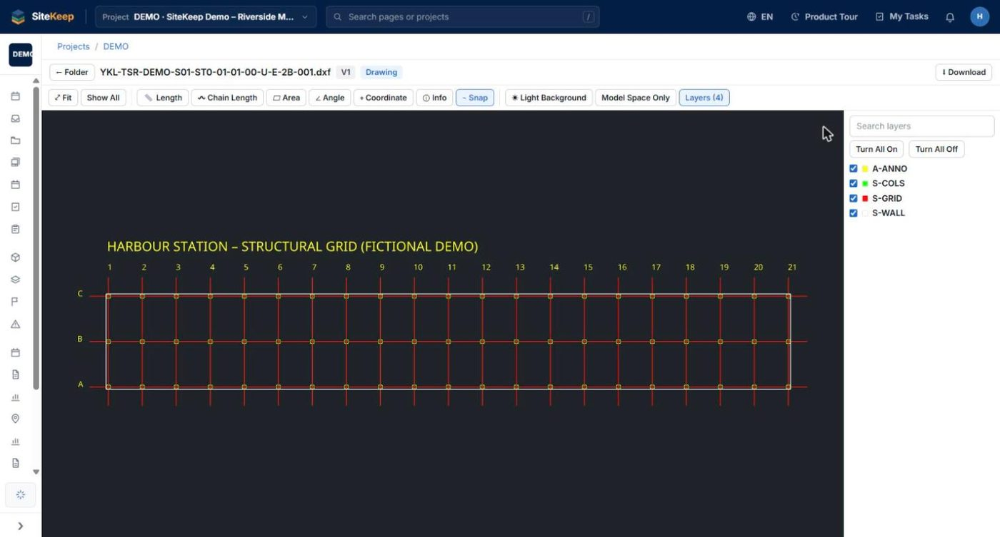

<p align="center"></p>

# SiteKeep

**İnşaat projeleri için açık kaynak, gizliliği önceleyen ortak veri ortamı (CDE).**

SiteKeep bir projenin dokümanlarını, BIM modellerini, sorunlarını ve onaylarını tek yerde, kendi sunucunuzda tutar.
ISO 19650'yi izler; buildingSMART OpenCDE ve BCF standartlarını uygular. 3B görüntüleyici
[That Open Company](https://thatopen.com) bileşenleri üzerine kuruludur.

[English README](README.md)

| Sürüm | Nedir |
|---|---|
| **SiteKeep Community** | Bu depo, [AGPL-3.0](LICENSE) ile ücretsiz: dokümanlar, klasör yetkileri, versiyonlar, isimlendirme standartları, onay akışları, ISO 19650 kuralları ve denetim kaydı, paftalar, karşılaştırma ve işaretleme, sorunlar ve BCF, model görüntüleyici, transmittal ve yazışmalar, CSV dışa aktarmalı rapor listeleri, OpenCDE API'leri. Lisans yok, sınır yok. |
| **SiteKeep Enterprise** | Community ve ücretli modüller: Cost, Field, Coordinate, Planning, AI, Manage, Connect, Platform ([modüller](docs/modules/README.md)). Kurulum başına lisanslanır; modüller bu depoda değildir. |

Arayüz İngilizce ve Türkçedir.

## Özellikler

| Alan | Neler var |
|---|---|
| Kullanıcılar | Yerel kullanıcılar, firmalar, sistem ve proje yöneticileri, davetler, Google ile giriş, API erişim anahtarları |
| Projeler | ISO 19650 klasör şablonu (Çalışmada / Paylaşılan / Yayımlanan / Arşiv), proje şablonları ve kurulum sihirbazı, üyeler, roller |
| Klasörler | Kişi ya da firma başına altı yetki seviyeli, aşağı doğru miras alan klasör ağacı |
| Dosyalar | Sürükle-bırak yükleme, versiyonlama (aynı ad = yeni versiyon), öznitelikler, SHA-256, doküman karşılaştırma |
| İsimlendirme | Klasörlere bağlanan ve yüklemede denetlenen proje isimlendirme standartları |
| Modeller | Sunucuda IFC → That Open Fragments dönüşümü, federe görüntüleyici, eleman seçimi ve özellikleri, model üzerinde işaretleme, DWG ve PDF önizleme |
| Paftalar | Antetten otomatik pafta listesi (antet şablonu, taranmış paftalar için çevrimdışı OCR), pafta setleri ve numaralı yayınlar |
| Sorunlar | 3B iğneler, BCF bakış açıları (kamera, modeller, seçili elemanlar, ekran görüntüsü), durum, öncelik, atanan, termin, BCF içe / dışa aktarma |
| Onaylar | Dokümanlarda inceleme ve onay zincirleri |
| ISO 19650 | Proje bazında kurallar: durum geçişleri yalnız onayla, yayında arşivleme, uygunluk ve revizyon kodları, tekil doküman kodları, görev ekibi WIP'i; madde eşlemesi ve test paketi [ISO 19650'ye göre tasarlanmış özellikler](docs/compliance/ISO19650.md) belgesinde (yazılım için ISO 19650 sertifikası yoktur) |
| Denetim | Her yazma, görüntüleme ve indirme değiştirilemez, zincirlenmiş denetim kaydına yazılır; CSV dışa aktarma |
| Raporlar | Her alan için (dokümanlar, sorunlar, işler, onaylar …) görenin yetkileriyle liste ve CSV; rapor panoları (şablonlar, yapay zekâ, paylaşım, versiyonlar) Enterprise Platform modülüyle gelir |
| Entegrasyonlar | REST API (`/api/v1`), OpenCDE, yapay zekâ asistanları için yerel stdio MCP sunucusu (`apps/mcp`), ofis → PDF dönüşümü (Gotenberg, ONLYOFFICE, Collabora); sunucuda MCP ucu (`/mcp`) Enterprise AI modülüyle gelir |
| Gizlilik | Bir yönetici bir entegrasyonu (yapay zekâ, e-posta, giriş, Autodesk) açmadıkça sunucu kendiliğinden dışarıya hiçbir şey göndermez; her dış bağlantı Gizlilik Merkezi'nde listelenir, kaydedilir ve kapatılabilir |

## Ekran görüntüleri

Kurgusal bir demo projeden (Riverside Metro Line) ekran görüntüleri.

| | |
|---|---|
| <br>**Sürüm karşılaştırma:** bir çizimin iki revizyonu arasında değişen bölgeler, antet ve metin. | <br>**İnceleme ve onay:** dosya başına sonuç, tam zaman çizelgesi ve Shared'e kopyalanan onaylı dosyalar. |
| <br>**Sorunlar ve BCF:** BCF'ten aktarılan sorunlar; görüntü, durum, öncelik ve yorumlarla. | <br>**Tarayıcıda DWG ve DXF:** CAD yazılımı olmadan katmanlar, ölçümler ve yakalama. |

## Hızlı başlangıç (Docker)

Docker 24+ ve Compose v2 gerekir.

```bash
git clone https://github.com/sitekeephq/sitekeep.git && cd sitekeep
cp .env.example .env      # ADMIN_EMAIL, ADMIN_PASSWORD ve POSTGRES_PASSWORD değerlerini değiştirin
docker compose up -d
```

`http://sunucunuz:8080` adresini açıp `.env`'deki yönetici hesabıyla girin. HTTPS için önüne bir ters vekil
(Caddy, nginx, IIS ARR) koyun ve `SECURE_COOKIES=1`, `CDE_TRUST_PROXY=1` ayarlayın.

İki birimi birlikte yedekleyin: `pgdata` (veritabanı) ve `cdedata` (dosyalar ve model türevleri).

```bash
docker compose exec db pg_dump -U cde cde | gzip > yedek-$(date +%F).sql.gz
```

İnternete kapalı sunucular için HTTPS, gece yedeği, güncelleme ve geri alma içeren tek dosyalık bir kurulum paketi
var; [sürümler](https://github.com/sitekeephq/sitekeep/releases) sayfasından indirin.

## Geliştirme

Node.js 22 veya üstü.

```bash
npm ci
cp apps/server/.env.development.example apps/server/.env.development   # yönetici e-postası ve şifresini girin
npm run dev -w @sitekeep/server      # API → http://127.0.0.1:8787
npm run dev -w @sitekeep/web         # arayüz → http://localhost:5173
npm test                             # birim ve API testleri
npm run build && npm run e2e:install && npm run e2e   # uçtan uca testler (Playwright)
```

`DATABASE_URL` yoksa sunucu `DATA_DIR/db` altında gömülü PostgreSQL (PGlite) kullanır; başka bir servis gerekmez.

## Mimari

```
packages/shared     yetki seviyeleri ve miras, isimlendirme doğrulama, ortak tipler
packages/sdk        modül SDK'sı (MIT): SiteKeep Enterprise modüllerinin çekirdeğe nasıl bağlandığı
packages/cde-tools  cde_* MCP araçları (stdio sunucusu ve AI modülünün /mcp ucu aynı seti kullanır)
apps/server         Fastify + Drizzle ORM (PostgreSQL / PGlite), yerel disk depolama, IFC dönüşüm kuyruğu
apps/web            React + That Open Components görüntüleyici
apps/mcp            stdio MCP sunucusu, yerel dosya yükleme / indirme araçlarıyla
```

Yetki ve isimlendirme kuralları tek yerde (`packages/shared`) durur; sunucu, arayüz ve MCP aynı kodu kullanır.

## Yapay zekâ asistanlarını bağlama (MCP)

SiteKeep Community, kullanıcının bilgisayarında çalışan ve sunucunun REST API'siyle konuşan yerel bir MCP sunucusu
(`apps/mcp`, stdio) içerir. Her MCP istemcisi (Claude Code, Claude Desktop, Cline, Open WebUI, LibreChat …) onu
başlatabilir. **Hesabım → API erişim anahtarları** bölümünde oluşturulan bir anahtarla çalışır; her çağrı kullanıcının
kendi yetkileriyle yapılır ve denetim kaydına yazılır. Yerel dosya yükleme ve indirme araçları yalnız buradadır.

```json
{
  "mcpServers": {
    "sitekeep": {
      "command": "node",
      "args": ["/yol/sitekeep/apps/mcp/dist/index.js"],
      "env": { "CDE_URL": "https://sunucunuz", "CDE_TOKEN": "<erişim anahtarı>" }
    }
  }
}
```

`CDE_READ_ONLY=1` yazma araçlarını kapatır. Anahtarlar varsayılan olarak salt okunurdur; okuma-yazma anahtarı
yöneticinin iznini ister, projelerle ve bir süreyle sınırlanabilir.

Sunucuda çalışan bir MCP ucu (`https://sunucunuz/mcp`, Streamable HTTP, yerel kurulum gerekmez) Enterprise
[AI modülünün](docs/modules/ai.md) parçasıdır.

## Belgeler

Belgeler İngilizcedir. **[Harita](docs/MAP.md)** ile başlayın: neyin Community'ye, neyin bir Enterprise modülüne ait
olduğu, kodun nereye gittiği ve hangi kuralların geçerli olduğu.

- [Docker Compose kurulumu](docs/onprem/docker-compose.md) ve [kurulum paketi](docs/onprem/installation-bundle.md)
- [Yedekler](docs/onprem/backups.md), [izleme](docs/onprem/monitoring.md), [kapasite](docs/onprem/capacity.md)
- [Depo yapısı](docs/architecture/structure.md) ve [testler](docs/architecture/tests.md)
- [Modüller ve SDK](docs/modules/README.md)
- [Tüm belgeler](docs/README.md)

## Katkı ve güvenlik

Katkılara açığız: [CONTRIBUTING.md](CONTRIBUTING.md) ve [davranış kuralları](CODE_OF_CONDUCT.md).
Güvenlik açıklarını herkese açık bir issue'da değil, [SECURITY.md](SECURITY.md)'de anlatıldığı gibi gizlice bildirin.

## Lisans

SiteKeep Community [GNU Affero General Public License v3.0](LICENSE) ile lisanslıdır. Modül SDK'sı (`packages/sdk`)
MIT'dir. Üçüncü taraf bileşenler kendi lisanslarını korur (That Open Components / Fragments: MIT, web-ifc: MPL-2.0);
hepsi [THIRD_PARTY_NOTICES.md](THIRD_PARTY_NOTICES.md) dosyasında listelenir.

SiteKeep adı ve logoları 7Dimensions OÜ'nün markalarıdır ve AGPL kapsamında değildir; bkz. [TRADEMARKS.md](TRADEMARKS.md).
