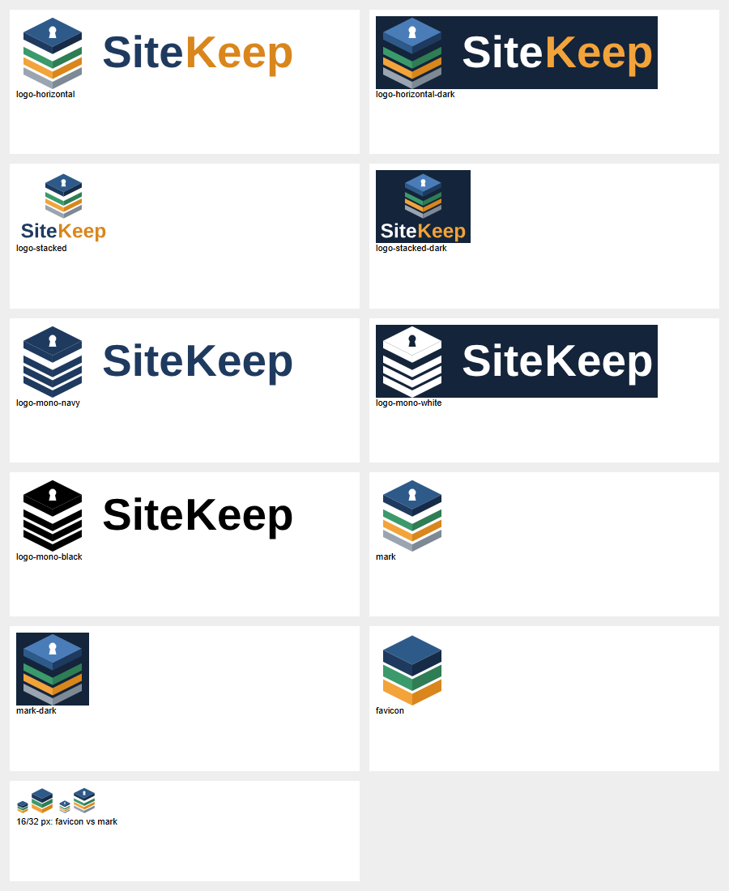

# SiteKeep marka dosyaları

Ürün adı her yerde **SiteKeep** yazılır: büyük S, büyük K, boşluksuz. Alan adı, paket ve komut adlarında küçük harf kullanılır: `sitekeep.org`, `@sitekeep/sdk`, `sitekeep`.



## Simge

Simge, ISO 19650 ortak veri ortamının dört durumunu üst üste koyar. Alttan üste:

| Katman | Durum | Renk |
|---|---|---|
| 1 | Çalışılıyor (WIP) | gri `#9AA5B1` |
| 2 | Paylaşıldı (Shared) | amber `#F2A33A` |
| 3 | Yayımlandı (Published) | yeşil `#3B9A6B` |
| 4 | Arşiv (Archive) | lacivert `#2E5A8A` / `#1F3A5F` |

En üstteki arşiv katmanındaki anahtar deliği "veriler sizde, güvende" anlamını taşır.

## Dosyalar

SVG'ler uygulamanın statik klasöründedir: [apps/web/public/brand](../../apps/web/public/brand); uygulama
onları `/brand/<dosya>` adresinden sunar (sekme simgesi `/brand/sitekeep-favicon.svg`). Arayüzdeki simge
ve yazı [BrandMark.tsx](../../apps/web/src/shared/ui/BrandMark.tsx) ile çizilir (aynı şekiller; 48 px'in
altında favicon çizimi).

| Dosya | Kullanım |
|---|---|
| `sitekeep-logo-horizontal.svg` / `-dark.svg` | Ana logo: web sitesi başlığı, uygulama üst çubuğu, belgeler |
| `sitekeep-logo-stacked.svg` / `-dark.svg` | Kare alanlar: giriş ekranı, sosyal medya profili |
| `sitekeep-logo-mono-navy.svg`, `-black.svg`, `-white.svg` | Tek renk baskı, kaşe, belge antedi |
| `sitekeep-mark.svg` / `-dark.svg` | Yalnız simge (48 px ve üstü) |
| `sitekeep-favicon.svg` | 16–32 px: tarayıcı sekmesi. Sade sürüm: üç katman, anahtar deliği yok |

`-dark` dosyaları koyu zemin (`#14243A`) içerir.

## Renkler

| Ad | Açık zemin | Koyu zemin |
|---|---|---|
| "Site" yazısı | `#1F3A5F` | `#FFFFFF` |
| "Keep" yazısı | `#D9861C` | `#F2A33A` |
| Koyu zemin | — | `#14243A` |

## Yazı tipi

Yazı, Liberation Sans Bold'dan (SIL Open Font License 1.1, `apps/server/assets/fonts/`) çizgiye dönüştürülmüştür; SVG'ler yazı tipi yüklü olmadan da aynı görünür. Bu ilk sürümdür; marka tescilinden önce özel bir yazı tipiyle yenilenebilir.

## Sürüm adları

**SiteKeep Community** (modülsüz çekirdek) ve **SiteKeep Enterprise** (modüllerle). Uygulama hangisi
olduğunu kurulu modüllerden çıkarır (MIMARI.md → Sürümler).

## Yeniden üretme

SVG'ler [make_brand.py](make_brand.py) ile Liberation Sans'tan üretilir; uygulamanın kullandığı klasöre yazar:

```bash
pip install fonttools
python docs/brand/make_brand.py . apps/web/public/brand
```

Önizleme (`preview.png`) elle güncellenir.

## Kurallar

- Logoyu döndürme, gerdirme, renklerini değiştirme ya da gölge ekleme.
- Logonun çevresinde simge yüksekliğinin en az dörtte biri kadar boşluk bırak.
- Simge 48 px'in altında kullanılacaksa `sitekeep-favicon.svg` kullan.
